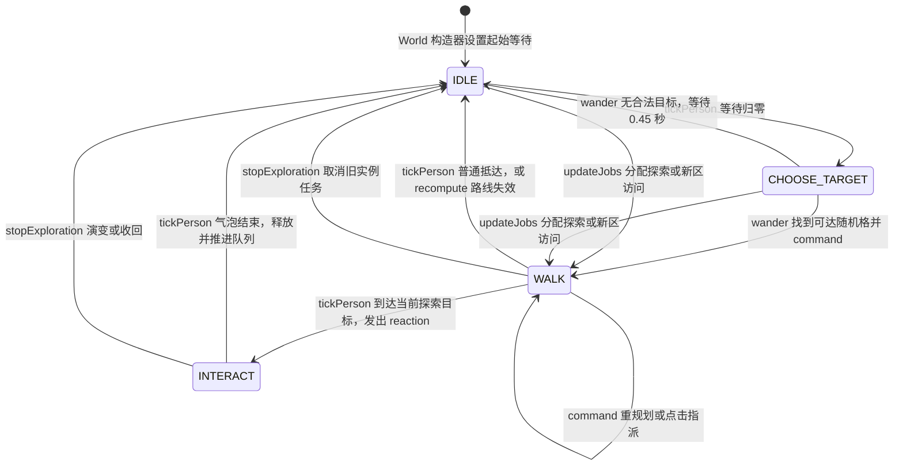

# 居民行为审查

## 当前状态机

`dist/main.js` 的 `Lab.update` 推进 `World.update` 并消耗事件。图中状态名来自 `dist/world.js`。

手动移动与任务分配由 `command` 广泛复用，没有一套独立于该状态机的 AI 控制器。暂停冻结更新，单步更新上限 .18 秒。

## 实际触发与调度

- **固定调度。** 放置和成功演变由 `World.place/evolve` 调用 `explore`。同物件在当前 job 或 FIFO 中时跳过重复排队。手动探索也可入队。每次最多一件探索作业，居民按地图 spawn 顺序探探→造造→慢慢执行。新区访问进行中暂缓启动新探索；已有探索先完成，扩张访问才开始。
- **发现与靠近。** `updateJobs` 为当前居民挑未被其他居民占用、即将踏入或设为目标的互动格，以曼哈顿距离排序，并用 `command/route/shortest` 走四邻 BFS。成功派路时发 `noticed`；即使居民尚未抵达，Memories 已显示“发现”。没有视距扫描、邻近感知或自动逐帧识别场上物件。
- **实际接触。** `tickPerson` 到达 job 指定格才进入 `INTERACT`，显示该物件 `reactions` 对应居民索引的文案，并发 `reaction`。`Lab.update` 交给 `observer-bridge.js:resident` 写入事件。互动结束归队，之后继续游荡。苹果屋当前互动是到门前和显示反馈；入屋、坐下、储物等行为未实现。
- **用途提议与确认。** Bridge 在真实 `reaction` 时，用当前形态匹配本地固定文案并写入首条提议。玩家确认后由 `confirmEvolution` 委托 `World.evolve`。失败保留提议和原形态，成功写确认及演变、清除提议并安排下一次探索。下一形态的接触仍要走真实路线。
- **随机部分。** `idle` 随机挑居民休息时长，`wander` 从曼哈顿距离 3–10 且可走、未被占用或预订的候选中随机取目标，失败逐一尝试。路径与探索排队顺序由条件和规则决定。
- **时间参数。** 探探、造造、慢慢每格约 0.21 / 0.25 / 0.30 秒，游荡后的休息分别为 0.40–1.15 / 0.65–1.45 / 0.90–1.85 秒；探索气泡约 1.90 / 2.12 / 2.34 秒。新区到达后等待 1.65 秒。探索入口暂不可达时，按世界时钟重试约 4 秒，超时换下一位。没有按物件或行为类型配置的全局冷却。
- **个性边界。** 现有差异来自步速、等待区间、造型、排列顺序和每位居民的台词。没有“探探更喜欢陌生物件”这类偏好权重，也没有根据记忆和目标动态制定计划的 AI。
- **恢复边界。** 运行时的 job、步进进度和气泡不做完整持久化。Bridge 恢复世界格和存档位置；某形态尚无互动记录时重新提交探索。所有居民在一次任务里都错过入口时当前任务结束，实时自动重试整个作业尚未实现。

## 小步优化

优先维持真实 `reaction` 作为提议的唯一触发。后续可以在选择第一位探索居民时引入数据化偏好作为排序分数，例如探探对新物件优先、造造对设施优先、慢慢对休息点优先。同分继续使用现有顺序。再考虑对已去过的物件加短冷却，避免同一居民高频打卡。偏好不改变落点校验、门口可达和用户确认。
